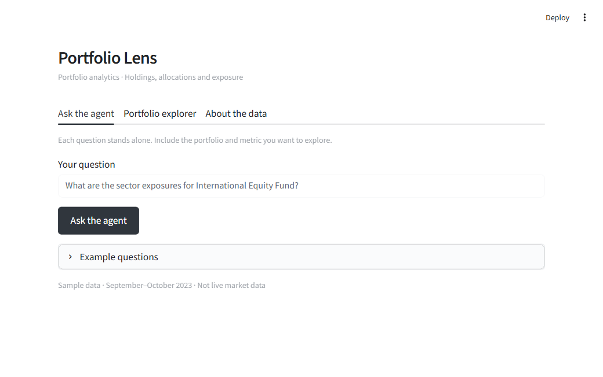
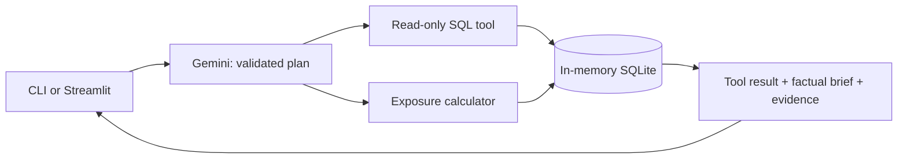

# Holdings Desk

**Ask a portfolio question. Inspect the answer, the data and the calculation.**

Holdings Desk turns natural-language questions into read-only SQL queries or deterministic
stock-sector exposure calculations. Use the command line for a quick question or the
Streamlit workspace to inspect tables, charts and execution evidence.

[Quick start](#quick-start) · [Verification](VALIDATION.md) · [Calculation guide](docs/METHODOLOGY.md) · [Original brief](assessment/README.md)



## Quick start

Use **64-bit Python 3.11–3.13**. You also need
an internet connection for setup/live AI and your own
[Gemini API key from Google AI Studio](https://aistudio.google.com/apikey).
No database server, Docker, Node.js or manual CSV import is needed.

### 1. Get the project

```sh
git clone https://github.com/shardulnarvekar/holdings-desk.git
cd holdings-desk
```

Alternatively, choose **Code → Download ZIP** on GitHub, extract the ZIP, and open a terminal
in the folder containing `setup_project.py`.

### 2. Install and configure

```powershell
python setup_project.py
```

This creates `.venv`, installs the pinned dependencies, checks them, and creates `.env`.
Open the generated `.env` in a text editor and set:

```dotenv
GEMINI_API_KEY=your-own-key-here
GEMINI_MODEL=gemini-3.5-flash-lite
```

Save `.env`. Your key stays local and is ignored by Git. Continue once setup prints
**Setup complete**. On macOS/Linux, use `python3 setup_project.py`.

### 3. Run

**Windows — required CLI:**

```powershell
.\.venv\Scripts\python.exe -m portfolio_agent
```

At `Ask >`, enter `How many portfolios do we have in total?` — expected result: **13**.
Every question is independent. Include the portfolio, metric and period you need; type `exit` to quit.

**Windows — optional web interface:**

```powershell
.\.venv\Scripts\python.exe -m streamlit run app.py
```

Open **http://localhost:8501**. Keep the terminal running; press Ctrl+C to stop it.
The CLI works without the web server. On macOS/Linux replace `.\.venv\Scripts\python.exe`
with `./.venv/bin/python`. Windows/Python 3.11 and 3.13 are verified locally.

## Try it

| Question | What it demonstrates |
|---|---|
| What are the names of all active portfolios? | SQL filtering |
| Show the top 5 holdings by cost basis in Growth Equity Fund. | Joins and ranking |
| What are the sector exposures for International Equity Fund? | Stock-weight calculator |
| Which active high-risk portfolio has the highest Technology exposure? | Both tools working together |

Use `--explain` to inspect SQL/formulas, or `--json` for machine-readable output:

```powershell
.\.venv\Scripts\python.exe -m portfolio_agent "How many portfolios?" --explain
.\.venv\Scripts\python.exe -m portfolio_agent --exposure "Balanced Portfolio"
```

The second command calculates directly without an API key. The Portfolio explorer does the
same in the browser. The optional CLI `--demo` is explicitly limited to preset examples;
it is not AI and is never counted as model evaluation.

## Verify the project

```powershell
.\.venv\Scripts\python.exe -m pytest -q
.\.venv\Scripts\python.exe evaluate.py --reference-check --extra
.\.venv\Scripts\python.exe evaluate.py --output reports/my-evaluation.json
```

The first two checks need no key. Reference checking validates expected data, **not AI accuracy**.
Live evaluation runs the 10 supplied questions. Add `--extra` for 8 additional development cases,
or `--ids 7` for one case. Each live question uses API quota; One invalid-plan correction, SQL repair and server retries may add calls.
The default 15-second pause between questions reduces request pressure. Daily quota/authentication
failures stop the run; checkpoints preserve completed results. Exit codes: 0 pass, 1 failed cases,
2 setup/reference error. See [current results and limits](VALIDATION.md).

## Design and scope



One agent, two tools. Gemini interprets intent; Python/SQLite produce the numbers.
There is no second model call to narrate answers, no chat memory and no external market feed.

| Requirement | Delivered |
|---|---|
| Natural-language SQL query tool | Structured plan, named parameters, bounded read-only execution |
| Stock-sector exposure calculator | Supplied holding weights grouped by sector; bonds excluded |
| Command-line agent | `python -m portfolio_agent` |
| Ground-truth evaluator | `python evaluate.py`, result and tool comparison |
| Documentation and error handling | Setup script, this guide, safe errors and bounded repair |
| Optional extras | Streamlit, evidence/CSV export, hybrid comparison, explicit equity-only basis |

The original dataset, schema and ground truth are unchanged. Default exposure uses supplied
weights without rescaling; the index fund's 98% coverage is reported rather than filled in.
Recorded AUM differs from quantity × price. These and the reference-specific cohort conventions
are explained in [the calculation guide](docs/METHODOLOGY.md).

## Repository

```text
portfolio_agent/       Database, planner, tools, orchestration and summaries
app.py                 Thin Streamlit interface over the same core
evaluate.py            CLI evaluator and independent exposure oracle
setup_project.py       Reproducible local setup
tests/                 Calculation, safety, provider, CLI and UI tests
reports/               Current evidence; earlier runs under archive/
docs/                  Preview and calculation/evaluation methodology
data/ + assessment/    Original supplied materials
```

## Troubleshooting

| Symptom | Action |
|---|---|
| Python not found | Install 64-bit Python 3.11–3.13 and reopen the terminal. |
| Missing modules | Rerun setup and use the `.venv` Python commands above. |
| Missing/rejected API key | Check `.env`, project access and that the filename is not `.env.txt`. |
| Rate limit or daily quota | Check your AI Studio quota; wait for reset. Direct calculations remain available. |
| Slow answer or temporary provider error | Try again later; model latency varies. Errors are not replaced with guessed answers. |
| Port 8501 occupied | Open the existing app or add `--server.port 8502`. |
| Ambiguous question | Restate the complete question with a portfolio and metric; prior questions are not remembered. |

## Provenance and license

Created by Shardul Narvekar for the PL Capital AI engineering exercise, using its historical
sample data. This is an independent project, **not an official PL Capital service or investment
adviser**. The logo identifies the exercise context and links to the official website.

Original code and documentation are [MIT licensed](LICENSE). Supplied assessment materials,
PL Capital branding and fonts have separate ownership/terms; see [third-party notices](THIRD_PARTY_NOTICES.md).

The recorded evaluations are development checks, not a promise of accuracy on unseen questions.
A private/public GitHub repository is separate from deploying a hosted application.
