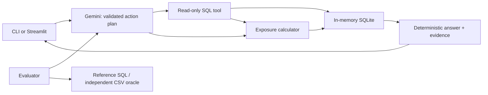

# Portfolio Lens

**Ask a portfolio question. Get an answer you can verify.**

A portfolio analytics agent with a command-line interface and a focused web workspace.
Gemini selects a tool; SQLite retrieves records and Python calculates sector exposures.
The same core powers the required command-line interface, evaluator and optional Streamlit UI.

Built for the PL Capital AI engineering assessment using its supplied historical sample dataset.
This is an independent project, not an official PL Capital product.


## Start here

**Recommended reviewer path (Windows, Python 3.13):** open a terminal in the extracted
repository folder, then run `python setup_project.py`. It creates the virtual environment,
installs pinned dependencies, and creates `.env` without overwriting an existing file.
Setup makes no API calls. Open `.env` in a text editor, add your own `GEMINI_API_KEY`, and save.

Start the required interactive CLI:

```powershell
.\.venv\Scripts\python.exe -m portfolio_agent
```

At `Ask >`, type `How many portfolios do we have in total?` (expected: **13**).
Each question is independent: include the portfolio, metric and period you need.
Type `exit` to quit. Add `--explain` to display SQL and calculation evidence, or `--json`
for machine-readable results. No database installation or manual CSV import is needed.

Optional UI: `.\.venv\Scripts\python.exe -m streamlit run app.py`.
The CLI does not require Streamlit to be running. Keep the UI terminal open and press Ctrl+C
to stop it. On macOS/Linux, use `python3 setup_project.py` and `./.venv/bin/python` instead.
Only Windows/Python 3.13 has been verified locally.

If Python is not found, install Python 3.13 and reopen the terminal. If modules are missing,
rerun setup and use the project's `.venv` Python. Save the key in `.env`, not `.env.txt`.
If port 8501 is occupied, launch Streamlit with `--server.port 8502`.

### Optional inspection without a key

The Portfolio explorer calculates sector exposure directly without AI. For a terminal example:

    .\.venv\Scripts\python.exe -m portfolio_agent --exposure "Balanced Portfolio"

The browser has no demo mode selector. The optional CLI `--demo` flag remains for offline
verification of explicit presets; it is not AI and does not count as model evaluation.

### Reproduce the checks

```powershell
.\.venv\Scripts\python.exe -m pytest -q
.\.venv\Scripts\python.exe evaluate.py --reference-check
.\.venv\Scripts\python.exe evaluate.py --output reports/live-evaluation.json
.\.venv\Scripts\python.exe evaluate.py --extra --output reports/live-extended.json
```

The first two commands need no API key. Reference checking validates expected data; it does not measure
AI accuracy. Live evaluation calls Gemini for all 10 supplied questions, or 18 with `--extra`.
To compare a model without changing the application default, use
`python evaluate.py --model gemini-3.6-flash --output reports/gemini-3.6-recheck.json`.
Expect API requests and account quota usage. A SQL repair can add one model call; transient server
errors get one transport retry. No retry is made automatically for a quota error.
Evaluation waits 15 seconds between questions by default; adjust with `--delay 30` for
stricter account limits. Provider failures stay visible in the report rather than being
discarded from the score.
Daily quota, authentication and unavailable-model errors stop further model calls and mark
the remaining cases skipped. A checkpoint is written after each case, so an interrupted run
retains its completed results with `status: in_progress`. Use `--ids 6 7 8` to test selected
cases without spending quota on the whole suite again.

Evaluation exits `0` when every case passes, `1` for failed cases, and `2` for setup/reference failures.
JSON reports retain expected and actual rows, selected tools, latency, errors, and a dataset hash.
See [validation notes](VALIDATION.md) for saved results and limitations. The latest full live
run passed 9/10 supplied questions; question 7 failed on an invalid column reference after
one repair. Question 7 passed its separate targeted recheck; the full-run score remains 9/10. An earlier run passed 10/10 required
questions and 6/8 extras. These development scores do not guarantee unseen-question accuracy.

## What is included

| Assessment requirement | Implementation |
|---|---|
| Natural language → SQL tool | Gemini structured plan + bounded read-only SQLite executor |
| Sector exposure calculator | Supplied stock weights grouped by sector; bonds excluded |
| Command-line agent | `python -m portfolio_agent` |
| Command-line evaluator | `python evaluate.py` |
| Run instructions and clean code | This README; small Python modules; meaningful failure tests |
| Optional enhancements | Inspectable evidence, Streamlit UI, explicit denominator choice, hybrid exposure comparison |



The SQL → calculator path is used only for hybrid questions, such as
"Which active high-risk portfolio has the highest Technology exposure?"
There is one agent, two tools, and no agent framework or vector database.
The schema is small enough to fit directly in model context.

## Financial definitions and data limitations

- **Exposure default:** `100 × SUM(current_weight)` for stock holdings in each sector.
  Do not replace weights with price-derived weights. Bonds are excluded without rescaling.
- **Equity-only basis:** divide the stock-sector weight by all stock weights. This is an explicit
  option, not the default. A portfolio with no equities returns no sector rows and an explanation.
- **Mixed portfolio example:** Balanced Portfolio has 36% stocks and 64% bonds. Technology is
  22% of the supplied whole-portfolio weights, or 61.111111% of the equity allocation.
- **Incomplete weights:** Total Stock Market Index Fund sums to 98%. The remaining 2% is
  unaccounted for in supplied weights; it is not assumed to be cash.
- **AUM versus holding value:** `portfolios.total_aum` is recorded AUM. Market-value queries use
  `quantity × current_price`, as in supplied reference question 7. These values do not reconcile
  in this dataset. Bond prices are treated exactly as that reference specifies; no face-value
  conversion is invented.
- **Different measures can differ:** International Equity Fund's Technology exposure is 36%
  by weights and 47.2% by the supplied market-value formula.
- **Source classifications:** sector and country come from the CSVs, even if a fund name suggests
  something else. Fund names are not a substitute for country data.
- **Named-sector market-value results:** by default, return portfolios that hold the requested
  sector, following the supplied reference. Zero-exposure portfolios are included only when
  explicitly requested. The phrase "for each portfolio" is ambiguous in the supplied question;
  this convention is documented rather than changing the expected data.
- **Historical sample:** dated observations span 25 Sep–09 Oct 2023. This is not live market data.
- **Diversification ratio:** distinct stock sectors / total holdings, rounded to 3 decimals,
  follows the supplied evaluation convention. It is not a general-purpose financial risk score.

## Reliability boundaries

- In-memory database rebuilt from unchanged CSVs; foreign keys and weight validity checked.
- SQLite `query_only` and an authorizer deny writes, schema changes, file attachment,
  introspection and non-approved functions. A SELECT prefix alone is not the safety boundary.
- Single-statement execution; named value parameters; no arbitrary Python execution.
- Approximately 2 seconds / 2 million SQLite VM steps per query, 500 output rows,
  SQL/expression/string limits. Truncated answers are labelled partial and cannot pass evaluation.
- One SQL repair for syntax/schema errors. Safety failures are not repaired automatically.
- Exact or unique token-based portfolio resolution. Ambiguous names ask for specificity instead
  of guessing. Fuzzy typo correction is intentionally not included.
- Final numbers and evidence come from tools. No second model call paraphrases or changes numbers.
- Short answer summaries are generated directly from returned fields, values and dates. Tables
  retain the full result. Summaries add no API calls and do not infer risk ratings or missing units.
- Provider errors are converted into actionable messages without logging API keys.

These are application safeguards for this local assessment, not a hardened multi-tenant sandbox.
Public hosting would require authentication, per-user quotas and deployment-specific controls.

## Evaluation methodology

The supplied file contains 8 reference SQL queries and 2 exposure tool specifications.
The evaluator executes reference SQL on the same source dataset. Exposure expectations are
computed through a separate CSV implementation, independent of the production calculator.

Results compare values rather than SQL strings or aliases. Numeric tolerance is `abs=1e-4`,
`rel=1e-8`; duplicates are preserved. The explicit top-5 request (question 5) and extra
cases explicitly marked ordered preserve row order. Reference SQL's incidental ordering
does not constrain questions that did not ask for an order.
Other cases use unordered row comparison. If all reference column names appear unambiguously,
the evaluator selects those columns by name, allowing reordered or additional descriptive fields.
Otherwise it requires the same column count and compares positions while ignoring aliases.
It records both the strict shape match and the comparison method. Missing rows, duplicate rows,
wrong values, and incomplete projections still fail. Exposure cases also check tool, resolved
portfolio and basis. This is a pragmatic evaluator, not a complete SQL-equivalence prover.

All interfaces and the evaluator are stateless: no earlier questions or answers are sent to Gemini.
The agent never imports the ground-truth file. The prompt contains documented domain definitions,
including the supplied diversification convention, but no stored answers. The 10 supplied cases
are development examples, not a blind test set. The additional 8 questions are also authored
development checks; neither score proves performance on unseen finance questions.

## Repository map

```text
portfolio_agent/
  database.py       CSV loading and query safety
  exposure.py       portfolio resolution and deterministic exposure
  models.py         validated plan and answer contracts
  planner.py        Gemini integration and explicit demo presets
  agent.py          tool routing, bounded SQL repair, answer assembly
  presentation.py   factual summaries from returned data
  __main__.py       command-line interface
setup_project.py    One-command setup; preserves existing configuration
app.py              Streamlit interface
assets/style.css    Minimal UI styles and responsive layout
evaluate.py         result-based evaluator and independent CSV oracle
tests/              safety, calculation, orchestration, SDK and UI tests
reports/            generated reference and verification results
assessment/         unchanged original README and suggested requirements
data/               unchanged supplied CSVs
database_schema.sql / ground_truth_dataset.json   unchanged supplied files
```

## Reviewer walkthrough (about two minutes)

1. Run the CLI and ask a question; optionally open the UI to inspect the same data.
2. Open the calculation details: the formula, denominator, and source are visible.
3. Explore Balanced Portfolio and switch between whole-portfolio and equity-only percentages.
4. Inspect Total Stock Market Index Fund to see the 98% weight warning.
5. Ask an unfamiliar question and run the live evaluator.

## References

- [Original assessment instructions](assessment/README.md)
- [Google Gen AI Python SDK](https://googleapis.github.io/python-genai/)
- [Gemini structured output documentation](https://ai.google.dev/gemini-api/docs/structured-output)
- [Streamlit documentation](https://docs.streamlit.io/)
- [PL Capital official website](https://www.plindia.com/) — visual context only; no official logo or endorsement implied.
